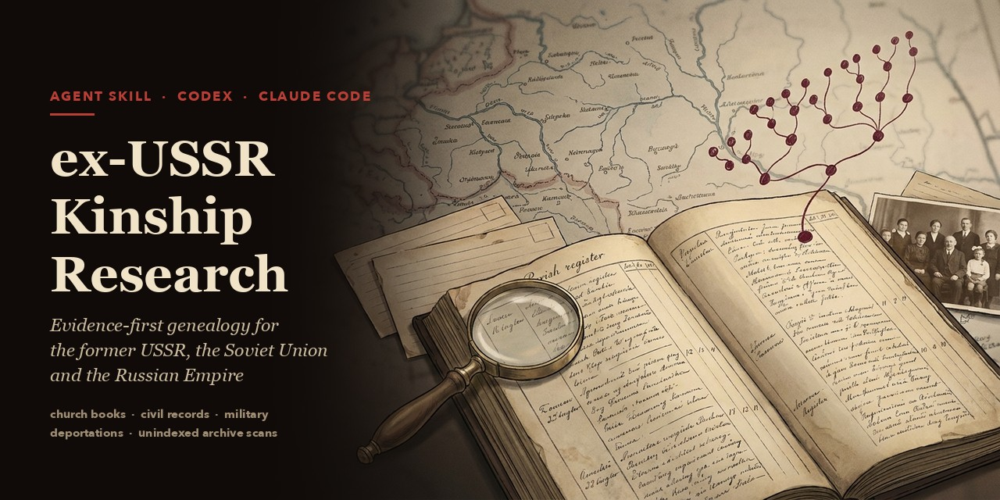

# ex-USSR Kinship Research



Languages: [English](README.md) / [Русский](README.ru.md) / [Беларуская](README.be.md) / [Қазақша](README.kk.md) / [Українська](README.uk.md) / [Polski](README.pl.md) / [Deutsch](README.de.md) / [Română](README.ro.md) / [Eesti](README.et.md) / [Latviešu](README.lv.md) / [Lietuvių](README.lt.md) / [ქართული](README.ka.md) / [Հայերեն](README.hy.md) / [Azərbaycanca](README.az.md) / [Кыргызча](README.ky.md) / [Тоҷикӣ](README.tg.md) / [Türkmençe](README.tk.md) / [O‘zbekcha](README.uz.md)

Котормонун датасы: 2026-жылдын 28-октябры. Долбоорду колдоочу котормолорду ай сайын карап чыгат; англисче README-де жаңыраак өзгөртүүлөр болушу мүмкүн.

**ЖИ агенттери үчүн далилдерге таянган генеалогиялык көндүм (Codex, Claude Code жана башка Agent Skills чөйрөлөрү).** Ал агентти мурдагы СССРдин, Советтер Союзунун жана Россия империясынын аймагындагы үй-бүлө тарыхын кылдат изилдөөчүгө айландырат. Агент чиркөө китептерин жана жарандык абал актыларын, аскердик, сүргүн жана репрессия документтерин, ошондой эле индекстелбеген архивдик скандарды окуйт. Ар бир табылган маалыматтын булагын текшерүүгө мүмкүнчүлүк берет, жазууну анын чечмеленишинен ажыратат жана эмне далилденгенин, эмне далилденбегенин ачык айтат.

Камтуу чөйрөсүнө мурдагы 15 советтик республиканын баары кирет: Россия, Украина, Беларусь, Молдова, Эстония, Латвия, Литва, Грузия, Армения, Азербайжан, Казакстан, Кыргызстан, Тажикстан, Түркмөнстан жана Өзбекстан. Архивдер окуя болгон учурдагы тарыхый юрисдикцияга жана документтерди азыр сактап турган мекемеге жараша тандалат; аймактык мисал жергиликтүү изилдөөнүн ордун баспайт.

Көндүмдүн көрсөтмөлөрү орусча жазылган, бирок **агент сиз менен сиздин тилиңизде сүйлөшөт**: англисче, украинче, орусча, полякча, немисче жана башкалар. Булактардан үзүндүлөрдү түпнуска жазылышында, котормосу менен берет жана издөө сурамдарын документтердин тилинде түзөт.

---

## Эмне кылат

- **Ишти баштоо жана чегин аныктоо.** Бир изилдөө суроосу, белгилүү фактылар, ким тирүү болушу мүмкүн жана кайсы аракеттерге жол берилбейт.
- **Кайра текшерилүүчү реестрлер.** Адамдар, артефакттар, ырастоолор, туугандык байланыштар жана толук издөө журналы (CSV), ошондой эле жыйынтык отчеттун үлгүсү.
- **Тарыхый юрисдикция модели.** Ар бир окуяны бүгүнкү картага эмес, *окуя болгон күндөгү* мамлекетке, губернияга, уездге, чиркөө приходуна же жарандык абалды каттоо органына байланыштырат.
- **Аталыш варианттарынын матрицалары.** Реформага чейинки орусча, украинче, полякча, румынча, немисче жана идишче формалар, атасынын аты, кыз кезиндеги фамилия жана транслитерациялар.
- **Булак стратегиясы.** Алгач түпнускалар, андан соң расмий каталогдор, индекстер, жарыяланган документ жыйнактары; санжыралар менен форумдар андан кийин гана издөө багытын көрсөткөн маалымат катары колдонулат.
- **Далил протоколу.** Ырастоолорго пайыз эмес, түшүндүрүлүүчү макамдар берилет: `hypothesis`, `single-source`, `corroborated`, `strongly-corroborated`, `contradicted`, `unresolved`. Бир жазуунун көчүрмөлөрү жана күзгү нускалары бир `independence_group` тобуна кирет, ошондуктан өз алдынча далил катары саналбайт.
- **Адамды аныктоо.** Үй номери, ата-энеси, чокундуруудагы өкүл ата-энеси, так туулган күнү же аскер бөлүгү сыяктуу айырмалоочу далил чыкмайынча аты-жөнү окшош адамдар өзүнчө `person_id` менен сакталат.
- **Аудит скрипти.** Корутунду жазардан мурун шилтемелердин бүтүндүгүн текшерип, начар ырасталган маалыматты белгилейт. Көз карандысыздык тобу шилтеме берилген артефакт ага киргенде гана эсептелет; ырастоону жөн эле жарыялап коюу жетишсиз. Жыйынтык отчет да текшерилет: ар бир келтирилген ID реестрде болушу, ар бир макам аларга дал келиши керек. Жыйынтыкта эмне али ырастала электиги же окулбайт деп белгиленгени көрсөтүлөт.
- **Мекемелерге суроо-талаптар.** Жеткиликтүү электрондук почта же расмий веб-куралдар аркылуу архивдерге, китепканаларга, университеттерге жана музейлерге так суроо-талаптарды даярдайт жана уруксат болгондо жөнөтөт. Керек болсо колдоого алынган почта интеграциясын же жөнөтүүгө даяр катты сунуштайт. Натыйжаны каттайт, кайталап жөнөтүүдөн сактайт жана жоопторду далил катары карайт. [Кат алышуу көрсөтмөсүн](references/correspondence.md) караңыз.
- **Мамлекеттик кызматтар.** Кайрылууга укукту жана натыйжа кантип берилерин текшерип, жарандык каттоо же архивдик сурамдын расмий жолун тандайт ([мамлекеттик порталдар](references/government-portals.md)).
- **Жыйынтык отчет.** Ар бир туугандык байланыш өзүнчө баскычтар менен, карама-каршылыктар, натыйжасыз издөөлөр жана кийинки так кадамдар менен көрсөтүлөт.
- **Индекстелген жазууларды максаттуу изилдөө.** Мурда эле бар мыйзамдуу браузер сеансы аркылуу жер же DGS боюнча ылайыктуу FamilySearch китептерин табат, конкреттүү жазууларды карайт жана булак уруксат берген далил үзүндүлөрүн гана сактайт. Жергиликтүү жардамчы куралдар сакталган үзүндүлөрдөн туугандарды, күбөлөрдү жана ат варианттарын издеп, алардын контекстин жана файлдардын текшерүү суммаларын сактайт. [Иш жүрүшү жана камтуу чектери](references/familysearch-indexes.md).
- **Туташкан FamilySearch MCP.** Туташкан серверди түзүмдүү издөөлөргө, профилдерге, туугандарга, булактарга жана так чектелген, кайра окуп текшерилүүчү уруксат берилген санжыра өзгөртүүлөрүнө колдонот. Индекстелген издөөнү индекстелбеген скандарды окуудан бөлөт жана коннектордун браузер, купуялык жана жазуу мүмкүнчүлүктөрүн чындап текшерет. [Иш жүрүшү жана жетүү чектери](references/familysearch-mcp.md).
- **Биринчи дүйнөлүк согуш булактарын издөө.** GWAR билдирүүлөрүн, госпиталдык, сыйлык жана согуш туткундарынын жазууларын адам же жер боюнча издейт, бузулуп жазылган жер атын чечмелөө үчүн сакталган карточкалардагы конуш аталыштарын салыштырат, анан түпнуска сүрөтүн табат. [Иш жүрүшү](references/ww1-search.md). Эки жардамчы курал тең бар артефакт реестрине жана издөө журналына маалымат берет; адамдын кимдигин же туугандыгын автоматтык түрдө аныктабайт.

Чыгарылыштардын тарыхы: [өзгөртүүлөр журналы](references/changelog.md).

<a id="install"></a>
## Орнотуу

Node.js орнотулган болсо, кошумча [Skills CLI](https://github.com/vercel-labs/skills) куралын колдонсоңуз болот:

```bash
npx skills add https://github.com/DenisSergeevitch/ex-ussr-kinship-research
```

CLI агентиңизди тандоого мүмкүндүк берип, демейкиде учурдагы долбоорго орнотот; бардык долбоорлордо жеке колдонуу үчүн `-g` кошуңуз. Node.js боюнча учурдагы талаптарды анын документтеринен караңыз.

Же репозиторийди түздөн-түз агентиңиздин көндүмдөр папкасына клондоңуз:

```bash
# Codex
git clone https://github.com/DenisSergeevitch/ex-ussr-kinship-research ~/.codex/skills/ex-ussr-kinship-research

# Claude Code (жеке көндүмдөр)
git clone https://github.com/DenisSergeevitch/ex-ussr-kinship-research ~/.claude/skills/ex-ussr-kinship-research
```

Бир долбоор үчүн папканы репозиторий ичиндеги `.claude/skills/` ичине салыңыз. Скрипттерге Python 3 жана стандарттык китепкана гана керек; `build_pdf.py` үчүн Chromium негизиндеги браузер да талап кылынат.

## Колдонуу

Үй-бүлө боюнча сурооңузду баяндаңыз. Агент колдо бар маалымат менен иштеп, суроолорго же жеткиликтүүлүк сурамдарына жооп күтүп жатканда да улантат. Мисалы:

- *«Чоң атамдын атасы 1930-жылдары Казакстанга сүргүнгө айдалган. Чиркөө жазууларынан анын ата-энесин табууга жардам бер.»*
- *«Бул жерде нике күбөлүгү менен жоокер карточкасынын скандары бар. Алар бир эле адамга тиешелүүбү, текшерип, далилдердин чынжырын түз.»*
- *«1890-жылдардагы Подолиядагы айылдын приходун жана керектүү FamilySearch тасмасын таап, X фамилиясы боюнча туулгандыгы тууралуу жазууларды оку.»*

Жеке иштин маалыматтарын көндүмдүн Git жумуш көчүрмөсүнөн тышкары сактаңыз. Көндүм папкасынан:

```bash
python scripts/init_case.py --case-dir ~/kinship-cases/my-case --research-question "Who were Maria's parents?" --subject-label "Maria"
python scripts/hash_artifact.py ~/kinship-cases/my-case/scans/marriage-1902.jpg   # ар бир сакталган артефакт үчүн SHA-256
python scripts/audit_evidence.py --case-dir ~/kinship-cases/my-case             # жыйынтык отчетко чейин реестрлерди текшерүү
python scripts/build_pdf.py --html ~/kinship-cases/my-case/pdf-source/report.html --out ~/kinship-cases/my-case/report.pdf
```

`init_case.py` көндүм папкасынын ичинде, `--force` менен да, иш түзүүгө жол бербейт. Кошумча коргоо үчүн Git эски иш папкаларынын кеңири тараган аттарын эске албайт; салым кошордон мурун, айрыкча бар ишти көчүрүп жатканда, индекске кошулган файлдарды текшериңиз.

`build_pdf.py` үчүн Chrome, Chromium же Edge орнотулушу керек (же `CHROME_PATH` көрсөтүлөт). Эгер `pypdfium2` бар болсо, `--png-dir` барактарды карап чыгуу үчүн PNG кылып да чыгарат.

Жергиликтүү же камтылган сүрөттөрү бар статикалык HTML колдонуңуз. Активдүү HTML жана тармактык сүрөт булактары кабыл алынбайт; булак шилтемелери басылуучу бойдон калат. Рендерлөө ийгиликсиз болсо, мурдагы PDF натыйжасы сакталат.

## Arca үй-бүлөлүк дарагы менен

[Arca](https://arca.denull.ru) — иш такта нускасы ЖИ агенттери үчүн MCP түйүнүн берген үй-бүлөлүк дарак колдонмосу (менюсундагы Agents…). Агент ага туташкандан кийин үй-бүлөнү изилдөө же дарак түзүү өтүнүчү тапшырманын жана туташуу берген мүмкүнчүлүктүн чегинде өзүнөн-өзү Arca аркылуу аткарылат; Arca жок болсо, эч нерсе өзгөрбөйт.

- **Arca-дан:** колдонуучуда бар дарак анын материалдары катары окулат. Документтер ырастамайынча андагы байланыштар гипотеза бойдон калат, ал эми келтирилген булактар жазуулардын өзүн табууга багыт берет.
- **Arca-га:** изилдөө аныктаган адамдар, чокундуруудагы өкүл ата-энелер жана күбөлөрү менен окуялар, ошондой эле `single-source` же андан жогору макамдагы үй-бүлөлүк байланыштар жазылат. Ар биринде тиешелүү жазуу көрсөтүлгөн булакка шилтеме жана далилденүү белгиси болот (ырасталган, бир булак, талаштуу); корутунду өзгөргөндө белги да өзгөрөт. Скандарды өткөрүү булактын шарттарына жана бар купуялык эрежелерине ылайык болот. Гипотезалар иште калат; колдонуучунун жазуулары эч качан үстүнөн жазылбайт, документтүү нуска алардын жанына кошулат. Долбоорду же натыйжа сакталуучу жерди ачык тандоо артыкчылыкка ээ.
- **Иштин папкасында:** Arca колдонулбагандай эле реестрлер, аралык материалдар, кезек жана издөө журналы сакталат, андыктан `audit_evidence.py` иштей берет.

Агенттин бардык өзгөртүүлөрү долбоор тарыхында өзүнчө сеанстар катары катталат; колдонуучу аларды карап, артка кайтара алат. Эрежелер [references/arca.md](references/arca.md) ичинде.

## Репозиторийдин түзүмү

```
SKILL.md                         негизги көрсөтмөлөр (иш жүрүшү, катуу эрежелер, тил саясаты)
references/
  source-strategy.md             булак иерархиясы, суроо үлгүлөрү, каталогдор, архивдик сурамдар
  correspondence.md              алуучулар, почта интеграциясы, уруксаттуу жөнөтүү жана жооптор
  government-portals.md          жарандык каттоо кызматтары жана сурам натыйжасын жеткирүү
  evidence-protocol.md           артефакт баалоо, макамдар, адамды аныктоо, карама-каршылыктар
  ex-ussr-locale-guide.md        юрисдикциялар, ат варианттары, календарлар, мезгилге жараша жазуу түрлөрү
  browser-and-captcha.md         браузер, кирүү, бир CAPTCHA аракети жана колдонуучуга өткөрүү, жыштык чектери
  privacy-and-safety.md          тирүү адамдар, жашы жете электер, ДНК, сезимтал табылгалар
  seed-sources.md                ишенимдүүлүк класстары бар баштапкы булактар
  field-lessons.md               чыныгы иштен алынган практикалык сабактар
  changelog.md                   чыгарылыш тарыхы
  photo-search.md                сүрөттөрдү издөө, аныктоо, даталоо жана сактоо
  habsburg-galicia-bukovina.md   Габсбургдар доорундагы жана кийинки Галиция менен Буковина
  chechnya-deportation.md        чечен үй-бүлөлөрү: 1944-жылкы депортация, атайын конуш, аттар жана аты өзгөргөн айылдар
  germany-forced-labour.md       Германиядагы мажбурлап иштетүү, 1941–1945: Arolsen Archives жана немис жарандык реестрлери

  bessarabia-moldova.md          Бессарабия, Молдова, МАССР жана Днестр чек ара аймагы
  familysearch-indexes.md       максаттуу браузер изилдөөсү, уруксаттуу жергиликтүү көчүрмөлөр жана камтуу
  familysearch-mcp.md           туташкан куралдар, түзүмдүү окуу, чектелген жазуу жана текшерүү
  ww1-search.md                 GWARдан адам/жер издөө жана булак сүрөтүнүн көрсөткүчтөрү
  arca.md                       Arca дарагы менен иштөө: ага эмне кирет, иште эмне калат
assets/                          баштапкы маалымат, CSV реестрлер, жыйынтык отчет үлгүсү,
                                 сүрөттөр README үлгүсү, изилдөө абалынын үлгүсү, окумдуу PDF үлгүсү (report-pdf.template.html)
scripts/                         init_case.py, hash_artifact.py, audit_evidence.py, build_pdf.py
                                 familysearch.py, gwar.py, register_search.py жана орток жергиликтүү талдоо модулдары
evals/discovery-and-logic.yaml   иштетүү жана ой жүгүртүү текшерүүлөрү
tests/                           модулдук тесттер (python3 -m unittest discover -s tests)
```

## Жоопкерчиликтүү колдонуу

- **Көзөмөл эмес, үй-бүлө тарыхы.** Көндүм тирүү адамдардын учурдагы дарегин, телефонун же аккаунттарын издөөгө барбайт жана отчеттордо алардын маалыматтарын азайтат.
- **Жетүүнү текшерүү.** Колдоо бар жана уруксат берилген болсо, агент ички браузердеги кадимки башкаруу аркылуу чыныгы CAPTCHA-ны бир жолу аткарып көрө алат. Колдонуучунун аракети керек болсо, мүмкүн болгондо тийиштүү өтмөктү ачып, URL менен керектүү аракетти көрсөтөт; аккаунтка колдонуучу өзү кирет. Сырткы чечүү кызматтары, коргоону, төлөм тосмосун, геобөгөттү же суроо жыштыгынын чегин айланып өтүү жана сыртка чыгып кеткен базалар колдонулбайт. [Браузер көрсөтмөсүн](references/browser-and-captcha.md) караңыз.
- **Сиздин так макулдугуңузсуз документтериңиз же ДНК маалыматтарыңыз үчүнчү тарап кызматтарына жүктөлбөйт.**
- **Сезимтал табылгалар** (депортация, репрессия, асырап алуу, күтүлбөгөн ДНК натыйжалары) калыс жана суроо талап кылган өлчөмдө гана баяндалат.
- **Уруксат берилген кат алышуу.** Колдонуучу уруксат бергенде көндүм бар куралдар аркылуу мекемелерге суроо-талап жөнөтө алат; мурда уруксат берилген жөнөтүүгө кайра уруксат сурабайт. Почтаны туташтыруу гана катка, тиркемеге же акы төлөнүүчү кызматка уруксат бербейт. Учурдагы расмий байланышты жана жол-жобону текшерип, кирүү маалыматтарын жана жеке иш боюнча каттарды көндүм репозиторийинен тышкары сактаңыз.

## Салым кошуу

Жаңы булактарды `references/seed-sources.md` файлына кошууга болот. Белгилүү болсо текшерилген ээсин, юрисдикциясын, жыйнагын, келип чыгышын, IDлерин, жеткиликтүүлүгүн, чектөөлөрүн жана текшерүү күнүн жазыңыз; боштуктарды божомол менен толтурбай белгилеңиз. Мисалдарга жеке маалыматтарды кошпоңуз.

Булак издөө жардамчылары Python стандарттык китепканасын жана бар иш реестрлерин колдонот. Жергиликтүү талдоону, GWAR текшерүү чекиттерин, жетүү каталарын, такталбаган камтууну жана синтетикалык маалыматтарда далил каттоону текшерүү үчүн `python3 -m unittest discover -s tests` аткарыңыз. FamilySearchтен табуу жана максаттуу кароо мурда эле бар мыйзамдуу браузер сеансын колдонот; Python жардамчылары сакталган үзүндүлөрдү талдайт. Жеке изилдөө файлдарын бул жумуш көчүрмөсүнөн тышкары кармаңыз.

## Лицензия

[MIT](LICENSE) © 2026 Denis Shiryaev.

---

Долбоорду колдоочу: Denis Shiryaev ([@DenisSergeevitch](https://github.com/DenisSergeevitch)).
